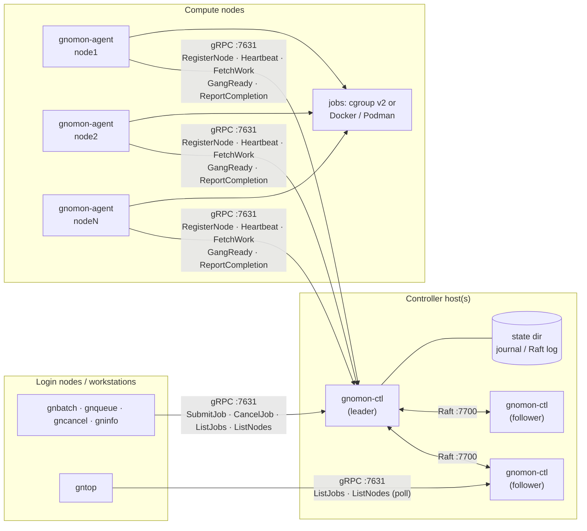
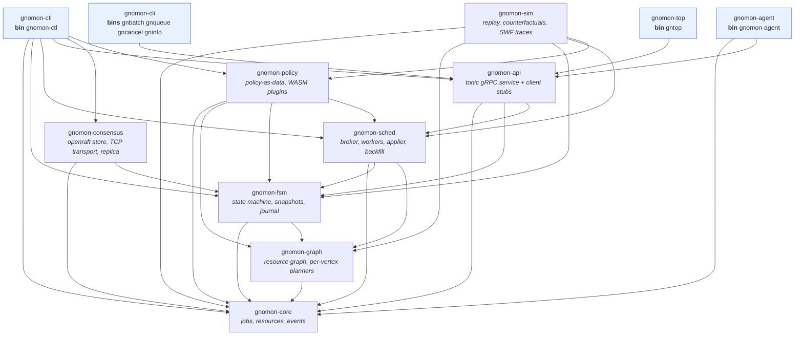
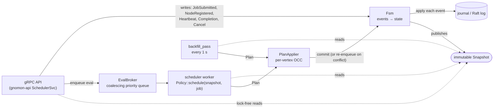
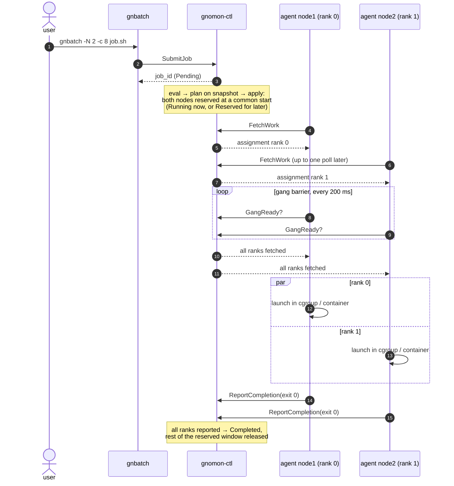
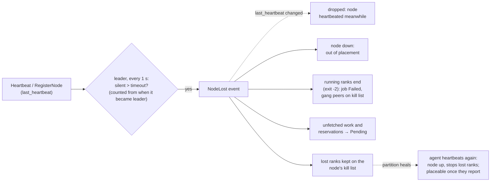
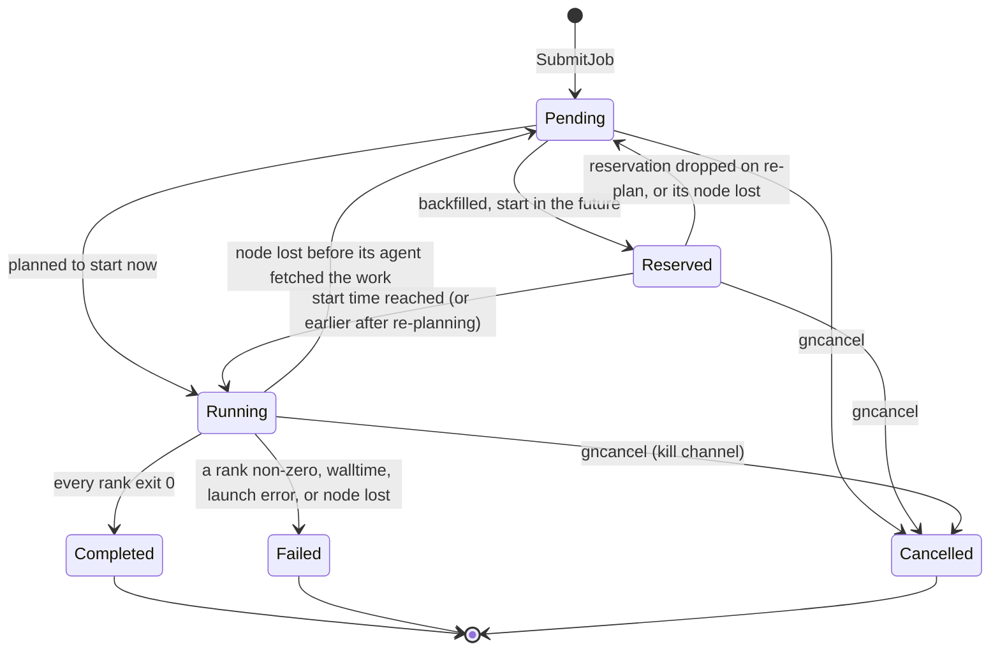
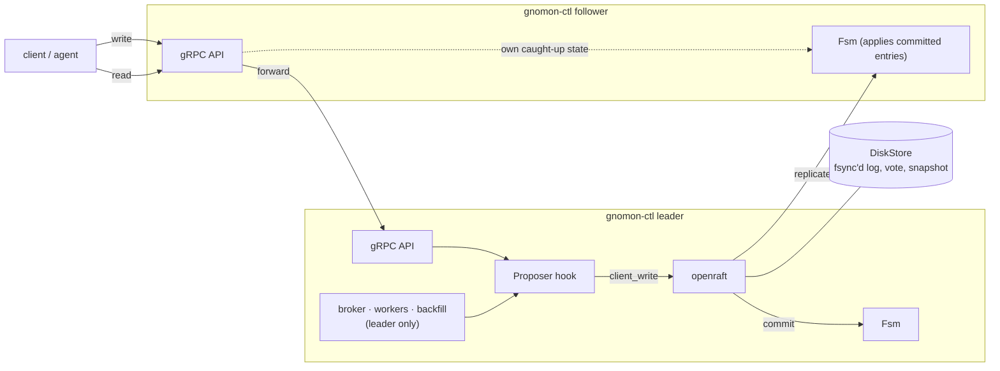
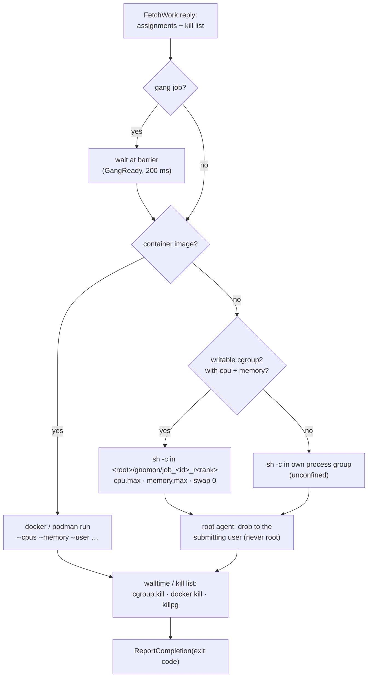

# Gnomon architecture

This document shows how Gnomon's processes and crates fit together, how a job moves through the
system, and how replication and node-side confinement work. The research and design rationale behind
it is in [SLURM_Scheduler_Research_and_Rust_Design.md](SLURM_Scheduler_Research_and_Rust_Design.md);
installation and per-binary usage are in [INSTALL.md](INSTALL.md).

The core idea: **scheduling is managing the time axis.** Every schedulable vertex of the resource
graph carries a planner of running spans and future reservations, the scheduler plans against
immutable snapshots without holding locks, and a single applier commits plans with per-vertex
optimistic concurrency.

## Deployment

- One controller is enough; with `--raft-id`/`--raft-peers`, three or five form a Raft group. Any
  replica answers; followers forward writes to the leader, and only the leader schedules.
- Agents take a list of controllers in `GNOMON_ADDR` and fail over on any error; the `gn*` tools try
  the list only until one connects; `gntop` talks to a single controller.
- All traffic is **pull-based**: agents poll `FetchWork` every heartbeat interval; the controller
  never connects to nodes.
- The API is defined in [`proto/gnomon.proto`](../proto/gnomon.proto) (service `Scheduler`).

## Crates

Arrows point from a crate to what it depends on. The shipped binaries (blue) are thin:
`gnomon-agent`, `gnomon-cli` and `gnomon-top` only share `gnomon-api`'s generated client with the
controller, so node and user tools never link the scheduler. `gnomon-sim` runs the production
`backfill_pass` against recorded or synthetic workloads, which is how the replay gate in CI checks
schedule quality. `gnomon-policy` (declarative policy and sandboxed WASM plugins for admission,
priority, runtime estimation and node scoring) builds on the scheduler: its estimator and node-score
plugins plug into `gnomon-sched`'s `RuntimeEstimator` and `Policy`. `gnomon-ctl` links it and hands
the submit handler admission and priority through `gnomon-api`'s `SubmitPolicy` trait, so the API
client crates never link wasmtime.

## Inside the controller

- **State machine (`gnomon-fsm`).** All cluster state is a deterministic function of an ordered
  event log and an injected clock. Readers (API, workers, `gntop`) get immutable snapshots and never
  wait on a writer: the structural fix for `slurmctld`'s global lock.
- **Planning (`gnomon-sched`).** Each submitted job becomes an *evaluation*; re-enqueueing a job
  whose snapshot has not changed is a no-op. A worker computes a plan as a pure function of the
  snapshot. The applier is the single commit point and rejects a plan only if a vertex it uses has
  changed *and* the plan no longer fits there.
- **Backfill.** Once a second the leader re-plans reservations (so reserved jobs start on time or
  earlier) and extends spans of jobs that overran their predicted runtime.
- **Durability.** With `--state-dir` every applied event goes to an fsync'd journal before it takes
  effect; a restart replays it and re-queues pending jobs.

## Job lifecycle

If a rank exits non-zero (or the job is cancelled while running), the controller puts every
unreported rank on a per-node **kill list** that is returned with the next `FetchWork`. Agents stop
those ranks (exit 143), release ranks still waiting at the barrier, and report ranks they never
received, so a gang always finishes, ending `Failed` or `Cancelled`.

### Lost nodes

The leader also watches heartbeats. A node silent for longer than `GNOMON_NODE_TIMEOUT_SECS` is
declared lost through a replicated `NodeLost` event, so every replica and every replay agree on it:

### Job states

## Replication

Every write, whether from the API, the plan applier or the backfill pass, goes through the
`Proposer` hook into the Raft log, and every replica applies the same committed events, including
the plan's read set, so each one revalidates identically. Without a quorum, writes fail with
`UNAVAILABLE` instead of being accepted and lost. A newly elected leader re-plans everything pending
on its first backfill pass. Membership is static (`--raft-peers`).

## On the node

The agent probes cgroup v2 and the container runtime once at start-up and logs which mode it uses.
Setting it up on real hosts (systemd delegation, rootless Docker) is covered in
[INSTALL.md](INSTALL.md#job-confinement-with-cgroup-v2).

## Testing and evaluation

| Layer | Where | What it covers |
|---|---|---|
| Unit and integration | `cargo test --workspace` | planner (with a brute-force oracle), OCC, replay, estimators, 3-replica Raft over TCP, agent launch against a fake cgroupfs and a fake `docker` |
| Replay gate | `bench.yml` | production scheduling path on synthetic and SWF traces against `results/replay_baseline.json` |
| Test kit | `testkit/run.sh`, `testkit/multinode.sh` | the same scheduler tests against Gnomon and Slurm, one node or a 3-node container cluster |
| Host validation | `testkit/validate-host.sh` | real cgroup v2 limits, OOM, `cgroup.kill`, real Docker and Podman |
