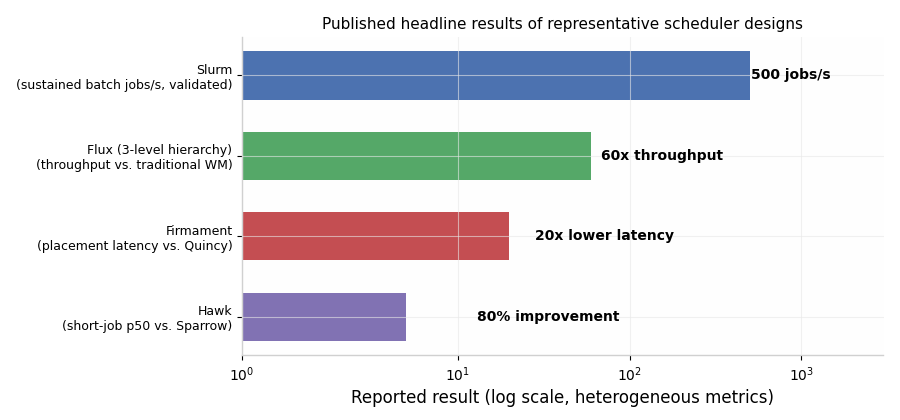
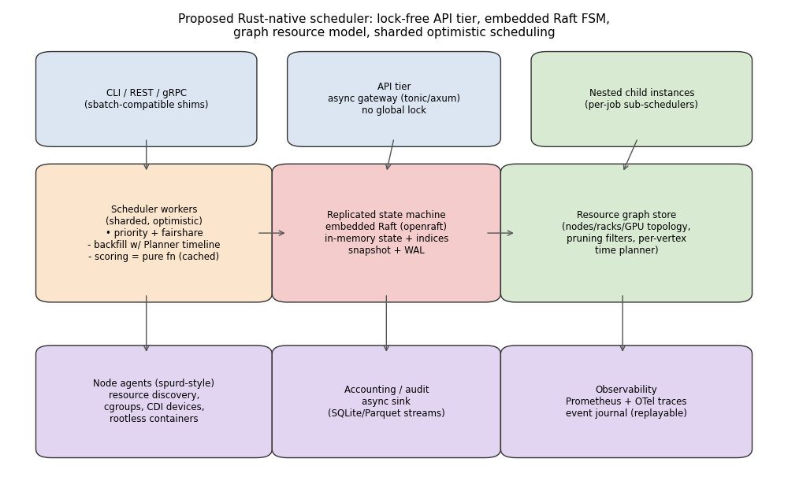
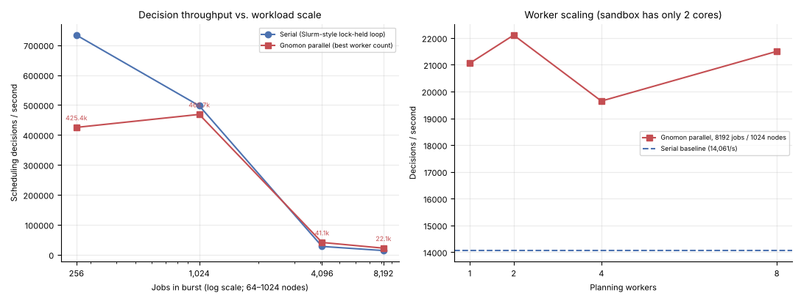
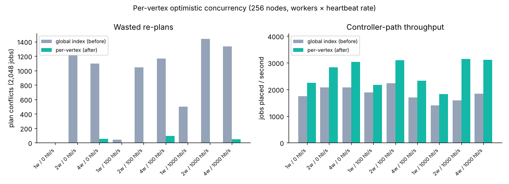
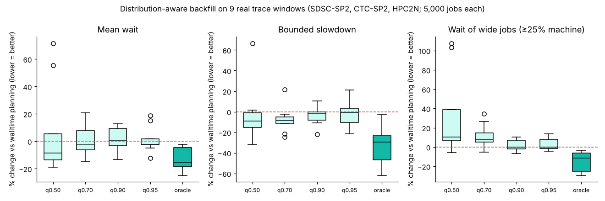
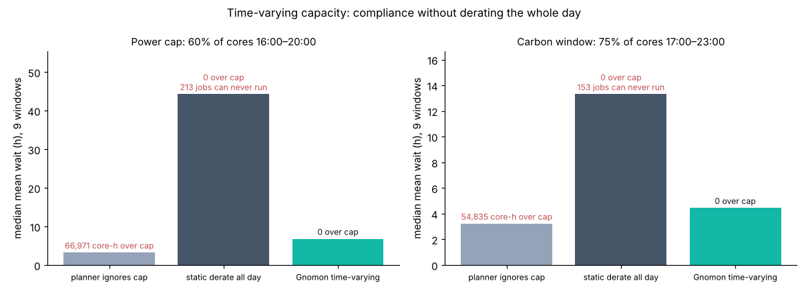

# From SLURM to a Rust-Native Scheduler: An Architectural Research Report

## Executive Summary

**Short answer: yes — there is demonstrably better architecture than SLURM's for a new scheduler, and Rust is an unusually good language for it.** SLURM remains the de-facto standard in HPC (present on roughly half of Top500 systems ([Emergent Mind](https://www.emergentmind.com/topics/cluster-systems-jobs-schedulers))) and its core design — a centralized `slurmctld` controller, per-node `slurmd` agents, FIFO-plus-backfill scheduling, and a ~100-plugin C extension model — is battle-tested at exascale. But its architecture has well-documented structural weaknesses: global mutexes that block all RPC traffic during scheduling cycles, a node-centric resource model that handles GPUs/topology as bolt-ons, single-point scheduling throughput limits, and a two-decade-old C codebase where concurrency correctness is enforced by convention ([GWDG Docs](https://docs.hpc.gwdg.de/how_to_use/slurm/how_scheduling_works/index.html), [JSSPP 2023](https://jsspp.org/papers23/JSSPP_2023_keynote_SLURM.pdf)).

The research literature and production systems since ~2010 have produced a rich taxonomy of alternatives — Google's Omega (shared-state optimistic concurrency), Firmament (globally optimal min-cost max-flow), Sparrow/Hawk/Mercury (distributed and hybrid), Flux/Fluxion (hierarchical graph-based scheduling, delivering **45–60x** throughput over traditional workload managers), and Kubernetes' ecosystem of gang schedulers (Volcano, Kueue, YuniKorn) ([LLNL](https://flux-framework.readthedocs.io/en/latest/guides/learning_guide.html), [USENIX OSDI'16](https://www.usenix.org/system/files/conference/osdi16/osdi16-gog.pdf)). Critically, the question is no longer hypothetical for Rust: **AMD's Spur, released in 2026, is a GPU-first job scheduler written in Rust with Slurm-compatible CLI/REST/C-FFI, embedded Raft consensus, and roughly 50K lines of Rust replacing 500K+ lines of C** ([AMD ROCm Blog](https://rocm.blogs.amd.com/software-tools-optimization/spur-gpu-job/README.html)).

The recommendation of this report: a Rust scheduler should combine (1) an **Omega/Nomad-style replicated in-memory state machine** with embedded Raft instead of MySQL-backed accounting and manual failover, (2) a **Fluxion-style graph resource model** with per-vertex temporal planners instead of SLURM's node-list data structures, (3) **sharded, optimistically concurrent scheduler workers** instead of SLURM's globally-locked scheduling loops, and (4) SLURM-compatible surface APIs for incremental migration. Each element is validated by at least one production system; the synthesis is what a greenfield Rust implementation uniquely enables.

---

## 1. How SLURM Actually Works: The Architecture Under Study

### 1.1 Daemon architecture and scheduling loops

SLURM's architecture is deliberately minimal: a centralized controller daemon, `slurmctld`, running on a primary server (with a passive backup for failover), and a lightweight agent, `slurmd`, on every compute node that launches tasks, monitors resources, and reports state via authenticated RPC over TCP — no SSH involved ([WWT](https://www.wwt.com/blog/workload-management-and-orchestration-series-slurm-workload-manager)). An optional third daemon, `slurmdbd`, fronts a MySQL/MariaDB database for accounting, fairshare history, and multi-cluster federation. This separation of control from execution is clean and has scaled to the world's largest machines — a full-system application on Frontier goes from submission to complete resource release in **under 13 seconds** ([JSSPP 2023](https://jsspp.org/papers23/JSSPP_2023_keynote_SLURM.pdf)).

Scheduling is not one algorithm but three interleaved loops with very different cost profiles. The **direct/event-driven loop** fires on job submission and stops at the first job it cannot place (strict FIFO, default queue depth 500); the **main scheduling loop** runs periodically (roughly every 2 seconds in typical configurations) and attempts jobs in priority order until the first unschedulable job per partition; and the **backfill loop** (default interval 45 seconds) builds a table of expected resource availability over a configurable future window (default 2880 minutes) and starts lower-priority jobs only if doing so provably does not delay any higher-priority job's expected start ([GWDG Docs](https://docs.hpc.gwdg.de/how_to_use/slurm/how_scheduling_works/index.html), [MSU HPCC](https://docs.icer.msu.edu/How_Jobs_are_Scheduled/)). Because backfilling with multifactor constraints is NP-hard, SLURM approximates: it caps the number of jobs considered per cycle (default 2000), per user (15), per partition (200), and truncates execution at `bf_max_time` (75 seconds) ([GWDG Docs](https://docs.hpc.gwdg.de/how_to_use/slurm/how_scheduling_works/index.html)).

The consequence that matters most architecturally is the locking model. Scheduling is executed inside `slurmctld` and holds mutexes on the job, node, and partition records; while a scheduling cycle runs, **the controller cannot answer ordinary RPCs** such as `squeue`, `sinfo`, or job-step creation requests. Slurm therefore interrupts scheduling when more than 50 RPCs are pending and caps the main loop at 8 seconds per cycle — the scheduler and the API literally fight over the same locks ([GWDG Docs](https://docs.hpc.gwdg.de/how_to_use/slurm/how_scheduling_works/index.html)). The backfill loop works around this by running "piecemeal": acquire locks, schedule for a couple of seconds, release locks for a sub-second window to service other work, and repeat ([JSSPP 2023](https://jsspp.org/papers23/JSSPP_2023_keynote_SLURM.pdf)). This is a workaround for a single-threaded-decision architecture, not a fix.

### 1.2 The plugin model and the resource data model

Slurm's extensibility comes from over 100 dynamically loaded C plugins covering scheduling policy, node selection (`select/cons_tres`), priority (multifactor with age/fairshare/job-size/QoS weights), topology, accounting, and authentication ([SchedMD](https://slurm.schedmd.com/overview.html)). Historically this has been a genuine strength — HP added core-level allocation in 2005 almost entirely as a new plugin, with ~80% of the change confined to plugin code ([JSSPP 2023](https://jsspp.org/papers23/JSSPP_2023_keynote_SLURM.pdf)). But plugins share the controller's address space and its locks, so a plugin cannot parallelize decisions or hold private concurrency invariants; the plugin ABI is also a C ABI, with all the memory-safety and versioning hazards that implies across a 500K+ line codebase ([AMD ROCm Blog](https://rocm.blogs.amd.com/software-tools-optimization/spur-gpu-job/README.html)).

The deeper limitation is the resource data model itself: SLURM thinks in **node records** (boards/sockets/cores/threads) with Generic Resources (GRES) — GPUs, licenses, burst-buffer bandwidth — attached as side attributes. Slurm's own architects acknowledge this: their stated future direction is "refactoring the core scheduling system to allow for different compute node hierarchies than the traditional board/socket/core/CPU model that is embedded in the existing scheduler subsystems" ([JSSPP 2023](https://jsspp.org/papers23/JSSPP_2023_keynote_SLURM.pdf)). Everything that doesn't fit the node rectangle — GPU interconnect topology (NVLink/XGMI), power envelopes, tiered storage, network switches — is forced through GRES strings and feature flags, which is why topology-aware GPU scheduling in SLURM is opt-in configuration rather than a first-class concept ([AMD ROCm Blog](https://rocm.blogs.amd.com/software-tools-optimization/spur-gpu-job/README.html)).

### 1.3 Measured limits

SLURM's throughput ceiling is well characterized. SchedMD validates **500 simple batch jobs per second sustained** in a carefully tuned high-throughput configuration, and only with specific knobs: `PriorityType=priority/basic` (dropping multifactor priorities), reduced `MinJobAge` so completed job records leave controller memory quickly, and the `defer` flag to skip event-driven scheduling on submission ([SchedMD HT Guide](https://slurm.schedmd.com/high_throughput.html)). Independent measurements put standard-configuration throughput near **100 jobs per second**, with researchers noting the design "is not suitable for so many short time jobs" ([Slurm-dev archive](https://slurm-dev.schedmd.narkive.com/xAFp5Mlq/performance-about-slurmctld), [TU Wien thesis](https://repositum.tuwien.at/bitstream/20.500.12708/229061/1/Sattari%20Sanaz%20-%202026%20-%20Improving%20HPC%20Efficiency%20with%20Advanced%20SLURM%20Modes%20of....pdf)). Scalability studies found the controller's responsiveness degrades between 4,096 and 8,192 nodes under the consumable-resources selection algorithm, with submission delays appearing precisely because the scheduler is invoked inside the submission path ([Georgiou et al.](https://www.cs.huji.ac.il/~feit/parsched/jsspp12/p8-georgiou.pdf)).

Beyond raw numbers, practitioners consistently flag the same operational gaps for modern workloads: no native elastic scaling or scale-to-zero, batch-only semantics that fit serving/interactive workloads poorly, static resource reservation causing fragmentation (a 3-GPU job strands the 4th GPU on a node), and configuration complexity that grows steeply on heterogeneous GPU clusters ([WhiteFiber](https://www.whitefiber.com/blog/understanding-slurm-for-ai-ml-workloads), [Rafay](https://rafay.co/ai-and-cloud-native-blog/introduction-to-slurm-the-backbone-of-hpc)).

| SLURM component | Design | Structural weakness |
|---|---|---|
| `slurmctld` controller | Single active process, backup for failover | Scheduling holds global mutexes; RPCs stall during cycles ([GWDG](https://docs.hpc.gwdg.de/how_to_use/slurm/how_scheduling_works/index.html)) |
| Main scheduler | Priority-ordered FIFO, stops at first unschedulable job | Head-of-line blocking by design ([JSSPP 2023](https://jsspp.org/papers23/JSSPP_2023_keynote_SLURM.pdf)) |
| Backfill | Reservation table over future window; NP-hard, heuristic caps | Heuristic depth/time caps trade quality for latency; minutes-long cycles at scale ([MSU HPCC](https://docs.icer.msu.edu/How_Jobs_are_Scheduled/)) |
| Resource model | Node records + GRES side-attributes | GPU topology, power, storage don't fit; acknowledged for refactoring ([JSSPP 2023](https://jsspp.org/papers23/JSSPP_2023_keynote_SLURM.pdf)) |
| Persistence | In-memory state + `slurmdbd`/MySQL for accounting | External DB required for accounting/fairshare; failover is manual-ish ([WWT](https://www.wwt.com/blog/workload-management-and-orchestration-series-slurm-workload-manager)) |
| Extensibility | ~100 C plugins in-process | No plugin isolation; C ABI; shared locking domain ([SchedMD](https://slurm.schedmd.com/overview.html)) |

---

## 2. The Design Space: Four Decades of Alternatives

The scheduler-architecture literature converges on a four-way taxonomy — monolithic, two-level, shared-state, and fully distributed — first crisply articulated by Google's Omega team and refined by the CamSaS taxonomy ([Omega paper](https://research.google/pubs/omega-flexible-scalable-schedulers-for-large-compute-clusters/), [CamSaS](https://www.cl.cam.ac.uk/research/srg/netos/camsas/blog/2016-03-09-scheduler-architectures.html)). SLURM, Borg, Kubernetes' kube-scheduler, and YARN are monolithic (Borg with an internally decoupled scheduler); Mesos is the canonical two-level design; Omega, Nomad, and Microsoft's Apollo are shared-state; Sparrow is fully distributed; Hawk and Mercury are deliberately hybrid.

### 2.1 Monolithic done right: Borg's lessons

Borg is the strongest evidence that a centralized scheduler can scale — a single Borgmaster manages a median cell of ~10,000 machines, with some cells ingesting over 10,000 tasks per minute — but the details of *how* are instructive. The scheduler is decoupled from the master and runs against a cached, slightly stale copy of cell state; the master validates decisions against current state and rejects infeasible ones. Scoring is made cheap by three techniques: cached scores invalidated only on significant change, equivalence classes of identical tasks scored once, and "relaxed randomization" that examines machines in random order until enough feasible ones are found rather than scoring the whole cell ([Borg summary](https://blog.acolyer.org/2015/05/07/large-scale-cluster-management-at-google-with-borg/), [Borg architecture](https://medium.com/@adityashete009/borg-large-scale-cluster-management-system-cbdcc4f8eb91)). HA comes from five-way Paxos replication of the master, not from a backup controller with manual failover.

The transferable insight for a new design is that **the decision function should be a pure function over a state snapshot**, with acceptance/rejection serialized at the state owner. SLURM instead interleaves decision and mutation under a single lock. Borg's pattern is exactly what Rust's ownership model expresses naturally: the scheduler gets an immutable `Arc<StateSnapshot>`, computes a plan, and submits it as a transaction.

### 2.2 Two-level and its discontents: Mesos

Mesos introduced offer-based two-level scheduling: a master offers subsets of resources to application frameworks, which accept or decline. This achieves framework isolation but suffers from hoarding, limited resource visibility (a framework never sees the whole cluster, so gang-style or constraint-heavy jobs suffer), and pessimistic locking ([Omega slides](https://csc.csudh.edu/btang/seminar/slides/Omega-Matt_Levan.pdf)). The Omega paper's simulation showed Mesos failing to schedule parts of Google's real workload precisely because of this restricted visibility. For an HPC-flavored design where large gang-scheduled MPI/training jobs are the norm, two-level scheduling is the wrong default — though the *offer* mechanism remains useful as an API for delegating sub-allocations (Flux's hierarchical model, §2.5, is the better-realized version of this idea).

### 2.3 Shared-state optimistic concurrency: Omega and Nomad

Omega's contribution is the proof that multiple parallel schedulers can all see complete cluster state and commit changes optimistically: each scheduler works on a local copy, attempts an atomic commit, and retries on conflict, with conflicts empirically rare in Google's production workloads. It eliminates head-of-line blocking (batch and service schedulers proceed independently) and makes new scheduling policies trivially deployable as additional scheduler processes ([Omega paper](https://research.google/pubs/omega-flexible-scalable-schedulers-for-large-compute-clusters/), [Omega notes](https://www.anantjain.xyz/posts/omega)). Gang scheduling is supported via all-or-nothing transactions, at some risk of starvation for very large gangs, mitigated by incremental transactions elsewhere.

Nomad is the production-hardened, open-source realization of this lineage: evaluations (units of scheduling work generated by any state change) are queued in a broker, dequeued by one scheduling worker per CPU core, evaluated optimistically, and the resulting plans are serialized through a leader-side plan applier backed by Raft-replicated state ([HashiCorp](https://www.hashicorp.com/en/blog/load-shedding-in-the-nomad-eval-broker), [Nomad deep dive](https://medium.com/@rpatil_60610/scaling-with-simplicity-unveiling-nomad-by-hashicorp-architecture-and-scheduling-1d3053a52939)). Two Nomad details deserve direct copying into a Rust design. First, the **in-memory replicated state machine** (go-memdb in Nomad; in Rust, a custom index structure behind the Raft FSM): reads become plain function calls with no serialization, and every object carries a Raft index enabling "wait until index N" consistency ([HN discussion](https://news.ycombinator.com/item?id=41209208)). Second, **idempotent-evaluation coalescing**: because re-evaluating a job against unchanged state yields the same plan, Nomad's broker cancels redundant queued evaluations, which cut Raft log volume by over 80% and scheduler load by 99% in incident benchmarks ([HashiCorp](https://www.hashicorp.com/en/blog/load-shedding-in-the-nomad-eval-broker)).

### 2.4 Optimality as a batch problem: Firmament

Firmament asks a different question: what if scheduling quality is treated as a global optimization rather than a sequence of greedy per-job decisions? It models the cluster as a flow network — tasks are flow sources, machines route to the sink, costs encode policy preferences (data locality, load spreading, preemption cost) — and runs min-cost max-flow over the entire workload, continuously rescheduling including running tasks ([OSDI'16](https://www.usenix.org/system/files/conference/osdi16/osdi16-gog.pdf)). The engineering findings are as valuable as the idea: the theoretically-inferior *relaxation* algorithm empirically beats cost-scaling on scheduling-shaped graphs, but has catastrophic edge cases for jobs over ~3,000 tasks, so Firmament runs two algorithms concurrently and takes whichever finishes first; incremental re-optimization (re-solving from the previous flow rather than scratch) is what makes sub-second placement at 12,500-machine scale possible — a **20x latency improvement over Quincy** and 6x better batch response time than four production schedulers ([OSDI'16](https://www.usenix.org/system/files/conference/osdi16/osdi16-gog.pdf), [ACM](https://dl.acm.org/doi/10.5555/3026877.3026886)). Early termination is explicitly rejected: approximate MCMF yields "unacceptably poor and volatile placements."

For a Rust design, Firmament is best adopted as an *optional policy engine* rather than the core loop — the HPC backfill problem (time-axis reservations, walltime estimates) does not map as cleanly to flow networks as placement does, and per-job time budgeting favors incremental solvers. But the meta-lessons — incremental solving, algorithm racing, batch amortization — generalize directly. Rust's safe parallelism makes "race two solvers on separate cores and take the first result" a trivially safe pattern rather than a memory-hazard.

### 2.5 The HPC-native successor: Flux and Fluxion

Flux is the most directly relevant alternative because it was designed at LLNL explicitly as the post-SLURM architecture for exascale systems like El Capitan, and it replaces *both* of SLURM's weak points — the central scheduler and the resource data model. Resources are vertices in a directed graph (cluster → rack → node → socket → core/GPU, but also switches, power domains, burst buffers), and relationships are edges on equal footing with the resources themselves; a job request is itself an abstract resource graph, and scheduling is a graph-matching problem solved by a traverser with pluggable scoring policies ([Fluxion paper](https://dl.acm.org/doi/fullHtml/10.1145/3624062.3624286), [Flux docs](https://flux-framework.readthedocs.io/en/latest/guides/learning_guide.html)). Because the graph is editable at runtime, heterogeneity that breaks SLURM's node-record model — e.g., El Capitan's Rabbit near-node flash, allocatable either per-rack or cluster-wide — is handled with **zero scheduler code changes** ([WORKS'23](https://works-workshop.org/2023/files/works23_patki.pdf)).

Scalability comes from three mechanisms that a Rust implementation should adopt wholesale. The **Planner** attaches an efficient time-point structure (an RB-tree of scheduled spans) to *every vertex*, giving backfill/reservation queries O(log n)-ish per-vertex behavior instead of SLURM's monolithic reservation table; **pruning filters** at high-level vertices keep aggregate availability summaries so the traverser can skip entire subtrees, updated by the scheduler-driven filter update (SDFU) algorithm; and **level-of-detail control** lets administrators pool indistinguishable resources (e.g., 5-core pool vertices) to shrink the graph, trading granularity for speed ([Fluxion paper](https://dl.acm.org/doi/fullHtml/10.1145/3624062.3624286)). Queueing policies (FCFS, EASY, conservative, hybrid backfill) live in a separate `qmanager` module from the matching engine (`resource` module) — a clean separation of *when* from *where* ([flux-sched GitHub](https://github.com/flux-framework/flux-sched)).

The headline result is hierarchical throughput: because any Flux instance can spawn child instances that schedule independently within their allocated subgraph, a 4,096-job ensemble workload ran **45x faster with two levels** of instances and **60x faster with three** than a traditional workload manager, scaling with core count where the traditional manager stayed flat ([Flux docs](https://flux-framework.readthedocs.io/en/latest/guides/learning_guide.html)). This is the strongest published evidence that delegation, not a faster central loop, is the answer to scheduling throughput. It also happens to be the exact shape of Rust's ownership discipline: a parent *moves* a subgraph of resources into a child instance, statically guaranteeing the child cannot double-allocate its parent's resources.

### 2.6 The cloud-native batch world: Volcano, Kueue, YuniKorn

The Kubernetes ecosystem has independently reinvented HPC scheduling concepts, which is itself evidence for their necessity. Volcano adds gang scheduling (all-or-nothing pod groups via `minAvailable`), queueing with hierarchical quotas, DRF fair-share, binpacking, and NVLink-aware topology placement as scheduler plugins ([Volcano docs](https://volcano.sh/docs/scheduler/plugins/gang/), [Medium](https://sagar-parmar.medium.com/beyond-native-kubernetes-scheduling-why-volcano-is-the-missing-piece-in-your-ai-infrastructure-ccc426b3351b)); Kueue provides admission-level queueing that works alongside rather than replacing kube-scheduler; YuniKorn replaces it with hierarchical queues and stronger multi-tenancy ([DEV.to comparison](https://dev.to/infracloud/batch-scheduling-on-kubernetes-comparing-apache-yunikorn-volcanosh-and-kueue-5b1g)). LLNL has even ported Fluxion into Kubernetes as a scheduling-framework plugin, bringing graph-based matching, gang scheduling, and AZ-topology awareness to K8s ([WORKS'23](https://works-workshop.org/2023/files/works23_patki.pdf)).

The lesson for a new scheduler is mostly about what *not* to copy: these systems inherit Kubernetes' etcd-mediated, controller-loop architecture, which is why teams report needing to assemble "a full ecosystem of operators, custom schedulers, and queueing layers" for what SLURM does with one binary ([AMD ROCm Blog](https://rocm.blogs.amd.com/software-tools-optimization/spur-gpu-job/README.html)). A purpose-built Rust scheduler can offer gang scheduling, queues, and topology natively rather than as a three-project stack.

### 2.7 Low-latency and hybrid designs: Sparrow, Hawk, Mercury

For completeness at the other end of the workload spectrum: Sparrow showed fully distributed schedulers using "power of two choices" probing can serve sub-second tasks with no central state; Hawk showed short jobs suffer under pure distribution at high load and fixed it with a hybrid (long jobs → centralized scheduler, short jobs → distributed, plus reserved capacity for short jobs and randomized work-stealing), improving short-job p50/p90 runtimes by 80%/90% over Sparrow under high load ([USENIX ATC'15](https://www.usenix.org/conference/atc15/technical-session/presentation/delgado)); Mercury generalized this with guaranteed (centralized) versus opportunistic (distributed) resource classes and dynamic load shedding ([Microsoft TR](https://www.microsoft.com/en-us/research/wp-content/uploads/2015/02/mercury-tr.pdf)). Microsoft's Yaq work adds that per-node queue management (not just placement) dominates tail latency, beating both YARN and Sparrow-style sampling by 1.7x and 9.3x in median JCT respectively ([Microsoft Research](https://www.microsoft.com/en-us/research/wp-content/uploads/2016/06/yaq-tr-1.pdf)).

These matter to a Rust design for one reason: the *workload classifier* (short vs. long, interactive vs. batch) should route jobs to different scheduling paths — a centralized quality path and a distributed/hierarchical latency path — rather than forcing one loop to serve both, which is precisely SLURM's three-loop compromise.

| System | Architecture | Concurrency model | Resource model | Signature result | Language |
|---|---|---|---|---|---|
| SLURM | Monolithic, 3 loops | Global mutexes, piecemeal release | Node records + GRES | ~100–500 jobs/s with heavy tuning ([SchedMD](https://slurm.schedmd.com/high_throughput.html)) | C |
| Borg | Monolithic, decoupled scheduler | Snapshot scheduling, master validates | Machine/task + allocs | ~10K machines/cell, 10K tasks/min ([acolyer](https://blog.acolyer.org/2015/05/07/large-scale-cluster-management-at-google-with-borg/)) | C++ |
| Omega | Shared-state | Optimistic transactions | Full cell state per scheduler | Conflicts rare in Google workloads ([Google Research](https://research.google/pubs/omega-flexible-scalable-schedulers-for-large-compute-clusters/)) | research |
| Mesos | Two-level offers | Pessimistic offers | Multi-dimensional | Hoarding/visibility issues ([Omega slides](https://csc.csudh.edu/btang/seminar/slides/Omega-Matt_Levan.pdf)) | C++ |
| Firmament | Centralized flow | Incremental MCMF, algorithm racing | Flow network | Sub-second at 12.5K machines, 20x over Quincy ([OSDI'16](https://www.usenix.org/system/files/conference/osdi16/osdi16-gog.pdf)) | C++ |
| Nomad | Shared-state (prod) | Eval broker + plan applier, Raft | Multi-dimensional attrs | Eval coalescing cut Raft load 80% ([HashiCorp](https://www.hashicorp.com/en/blog/load-shedding-in-the-nomad-eval-broker)) | Go |
| Flux/Fluxion | Hierarchical graph | Delegated child instances | Directed resource graph + Planner | 45–60x throughput via nesting ([Flux docs](https://flux-framework.readthedocs.io/en/latest/guides/learning_guide.html)) | C/C++ |
| Sparrow/Hawk | Distributed / hybrid | Two-choices probing + stealing | Fixed slots | Hawk: 80–90% better short-job p50/p90 ([ATC'15](https://www.usenix.org/conference/atc15/technical-session/presentation/delgado)) | Java |
| Volcano | K8s plugin framework | Controller loops on etcd | Pods/PodGroups/queues | Gang scheduling de-facto standard on K8s ([Volcano](https://volcano.sh/docs/scheduler/plugins/gang/)) | Go |
| **Spur** | Monolithic controller + Raft | Embedded Raft, async Rust | GPU-first + CDI topology | Slurm-compatible, ~50K LoC Rust vs 500K+ C ([AMD](https://rocm.blogs.amd.com/software-tools-optimization/spur-gpu-job/README.html)) | **Rust** |

---

## 3. The Rust Precedent: AMD Spur

The single most important finding of this research is that the question "should we write a scheduler in Rust?" has already been answered in production-grade code. AMD's **Spur** (Apache 2.0, `ROCm/spur` on GitHub) is an AI-native job scheduler written in Rust, announced in 2026, drop-in compatible with SLURM's CLI (`sbatch`, `squeue`, `srun`…), REST API, and even its C FFI via a `libspur_compat.so` shim ([GitHub](https://github.com/ROCm/spur), [Phoronix](https://www.phoronix.com/news/AMD-ROCm-Spur)). Its architecture validates several recommendations of this report independently:

- **Embedded Raft in the controller** (`spurctld`) replaces both SLURM's manual primary/backup failover and the external MySQL `slurmdbd` for scheduling state: leader election gives automatic failover in ~1–3 seconds, and all job/cluster state survives restarts without a separate consensus service ([AMD ROCm Blog](https://rocm.blogs.amd.com/software-tools-optimization/spur-gpu-job/README.html)).
- **GPU-first scheduling with topology as default**: device discovery through the Container Device Interface (CDI), interconnect awareness (XGMI/NVLink/PCIe), and fractional GPU allocation at the scheduler level — the things that are GRES plugin configuration in SLURM are the core data model in Spur ([AMD ROCm Blog](https://rocm.blogs.amd.com/software-tools-optimization/spur-gpu-job/README.html)).
- **A built-in rootless container runtime** (SquashFS images, user namespaces, CDI device injection) removes the Singularity/Apptainer dependency, and an integrated WireGuard mesh handles multi-site networking — capabilities chosen precisely because Rust makes shipping them as one static binary per component practical ([GitHub](https://github.com/ROCm/spur)).
- The codebase is **~50K lines of Rust against SLURM's 500K+ lines of C**, an order-of-magnitude size reduction for a growing subset of SLURM's functionality ([AMD ROCm Blog](https://rocm.blogs.amd.com/software-tools-optimization/spur-gpu-job/README.html)).

Spur also defines what it deliberately does *not* (yet) do, which is where a research-grade new architecture can differentiate: its scheduler remains a single centralized backfill loop (`plugin = "backfill"`, configurable interval), without Flux-style graph matching, hierarchical instances, or optimistic parallelism. In other words, Spur modernizes SLURM's *plumbing* in Rust but keeps its *scheduling architecture*. The opportunity for a new project is to modernize both.

---

## 4. Synthesis: A Better Scheduler Architecture in Rust

### 4.1 State management: embedded Raft FSM, not a database and not global locks

Replace both `slurmctld`'s lock-guarded in-memory state and `slurmdbd`'s external database with a replicated in-memory state machine on embedded Raft (e.g., `openraft`), following Nomad's and Spur's proven pattern: the FSM owns jobs, nodes, partitions, and queue state with application-specific in-memory indices; all mutations are Raft log entries; reads are lock-free function calls against the committed state; every object carries a Raft index so clients can request index-aware consistent reads ([HashiCorp HN](https://news.ycombinator.com/item?id=41209208), [AMD ROCm Blog](https://rocm.blogs.amd.com/software-tools-optimization/spur-gpu-job/README.html)). Accounting and audit become a separate async sink (SQLite locally, Parquet streams for archives) fed from the Raft log — the scheduling path never blocks on accounting I/O, unlike SLURM's MySQL dependency. Failover is Raft leader election (~1–3 s), not a passive backup controller. Rust's `openraft`/`raft-rs` crates and Tokio's ecosystem make this a solved integration problem rather than a research one.

### 4.2 Resource model: a directed graph with per-vertex temporal planners

Adopt Fluxion's model wholesale: resources as typed vertices (cluster, rack, switch, node, socket, core, GPU, memory pool, burst buffer, power domain), relationships as edges, jobs as abstract request graphs, scheduling as traverser-based matching with pluggable scoring ([Fluxion paper](https://dl.acm.org/doi/fullHtml/10.1145/3624062.3624286)). Attach a Planner (a balanced-tree structure over scheduled time points) to each vertex for backfill and reservation queries, and pruning filters at aggregate vertices for subtree skipping with scheduler-driven updates. In Rust this maps cleanly to an arena-allocated graph (indices, not pointers) with `petgraph` for algorithms, per-vertex Planner structures behind fine-grained `RwLock`s or epoch-based reads — concurrency granularity that C SLURM's global locks cannot express and that Rust's type system makes safe by construction. GPU topology (NVLink/XGMI domains) becomes ordinary graph edges rather than GRES strings.

### 4.3 Scheduling core: sharded optimistic workers plus a serialized plan applier

Follow the Omega/Nomad pattern: scheduling work is decomposed into *evaluations* (one per affected job), queued in a priority broker, and processed by a pool of workers against immutable state snapshots; resulting plans are applied serially by the Raft leader's plan applier, with conflict detection at commit time and retry-on-conflict ([Nomad deep dive](https://medium.com/@rpatil_60610/scaling-with-simplicity-unveiling-nomad-by-hashicorp-architecture-and-scheduling-1d3053a52939), [Omega](https://research.google/pubs/omega-flexible-scalable-schedulers-for-large-compute-clusters/)). Conflicts are rare in practice, so this buys parallelism across scheduling decisions — eliminating SLURM's scheduler-vs-RPC lock contention entirely, since the API tier only ever reads committed state. Three refinements, each with direct evidence behind it: **evaluation coalescing** (idempotent evaluations against unchanged state are droppable; cut Nomad's scheduler load 99% ([HashiCorp](https://www.hashicorp.com/en/blog/load-shedding-in-the-nomad-eval-broker))); **Borg's scoring optimizations** (score caching, equivalence classes, relaxed randomization — pure functions are trivially cacheable in Rust ([Borg](https://medium.com/@adityashete009/borg-large-scale-cluster-management-system-cbdcc4f8eb91))); and **a workload classifier** routing interactive/short jobs to a latency-optimized path (Hawk-style: small reserved partition, work-stealing) and batch jobs to the quality-optimized backfill path ([ATC'15](https://www.usenix.org/conference/atc15/technical-session/presentation/delgado)).

Backfill itself becomes a per-worker computation over Planner timelines rather than SLURM's monolithic reservation table under lock: a worker computes reservations against its snapshot, and the plan applier re-validates at commit. Where global optimization quality justifies its cost (e.g., nightly rebalancing, defragmentation), an optional Firmament-style MCMF engine can run as a separate worker with incremental re-solving and algorithm racing — safe in Rust because both solvers are pure tasks over immutable inputs ([OSDI'16](https://www.usenix.org/system/files/conference/osdi16/osdi16-gog.pdf)).

### 4.4 Scale-out: nested instances via ownership transfer

For throughput beyond a single controller's decision rate, implement Flux-style hierarchy: a job holding a large allocation can host a child scheduler instance that owns a subgraph of resources, transferred by the parent ([Flux docs](https://flux-framework.readthedocs.io/en/latest/guides/learning_guide.html)). Rust's ownership semantics make the safety invariant of this design — a child can never allocate outside its granted subgraph — expressible in the type system rather than by convention. This is the mechanism behind Flux's 45–60x ensemble throughput and is the single biggest differentiator a new implementation could have over both SLURM and Spur.

### 4.5 Interface and migration surface

The pragmatic path is Spur's: Slurm-compatible CLI shims (`sbatch`/`squeue`/`srun`/`scancel`), a REST API, and `#SBATCH` directive parsing, so existing user scripts and portals migrate incrementally; Kubernetes integration via an operator CRD for hybrid sites ([AMD ROCm Blog](https://rocm.blogs.amd.com/software-tools-optimization/spur-gpu-job/README.html)). Extensibility should use Rust traits compiled in or WASM-sandboxed plugins rather than in-process C-style shared objects — preserving SLURM's plugin flexibility without inheriting its memory-safety and ABI fragility. Observability (Prometheus metrics, OpenTelemetry traces, a replayable event journal) is nearly free in the Rust ecosystem and addresses a chronic SLURM operational pain point: understanding *why* the scheduler made a decision.

### 4.6 What to build, in order

1. **Foundation**: Raft-backed FSM + node agents + submit/run path (Spur parity, small scope).
2. **Graph resource model + Planner**: unlocks topology-aware GPU scheduling and correct backfill as first-class features.
3. **Sharded optimistic scheduler workers + evaluation coalescing**: removes the central-loop bottleneck.
4. **Policy layer as data**: fairshare/QoS/limits as declarative config over the graph, evaluated by pure functions.
5. **Nested instances and (optional) MCMF rebalancing**: extreme-scale throughput and global-quality passes.

| Design decision | SLURM today | Recommended Rust design | Evidence base |
|---|---|---|---|
| State & HA | In-memory + MySQL accounting, backup controller | Embedded Raft FSM, in-memory indices, async accounting sink | Nomad, Spur ([HashiCorp](https://www.hashicorp.com/en/blog/load-shedding-in-the-nomad-eval-broker)) |
| API responsiveness | Blocked by scheduler mutexes | Lock-free reads of committed state; decisions off the read path | Borg snapshot pattern ([acolyer](https://blog.acolyer.org/2015/05/07/large-scale-cluster-management-at-google-with-borg/)) |
| Resource model | Node records + GRES | Directed graph, per-vertex Planner, pruning filters | Fluxion ([ACM](https://dl.acm.org/doi/fullHtml/10.1145/3624062.3624286)) |
| Decision parallelism | Single threaded decision loops | Sharded workers, optimistic plans, leader-serialized apply | Omega/Nomad ([Google Research](https://research.google/pubs/omega-flexible-scalable-schedulers-for-large-compute-clusters/)) |
| Gang scheduling | Implicit (job = allocation) | All-or-nothing transactions, native | Omega, Volcano ([Volcano](https://volcano.sh/docs/scheduler/plugins/gang/)) |
| Throughput scaling | Tune-down heuristics (~500 j/s max) | Nested child instances owning subgraphs | Flux: 45–60x ([Flux docs](https://flux-framework.readthedocs.io/en/latest/guides/learning_guide.html)) |
| Placement quality | Greedy + heuristic backfill | Incremental backfill; optional MCMF global passes | Firmament: 20x latency, 6x response ([OSDI'16](https://www.usenix.org/system/files/conference/osdi16/osdi16-gog.pdf)) |
| Extensibility | In-process C plugins | Rust traits / WASM-sandboxed policies | — |

## 5. What Is Actually Novel in This Proposal

Every ingredient in §4 has a precedent — that is the point of grounding a design in evidence — but the *synthesis*, and several specific mechanisms, are novel relative to every existing system. This section is explicit about the boundary between validated prior art and genuinely new contributions.

### 5.1 The synthesis itself is unoccupied territory

No existing system combines the three structural upgrades at once. SLURM has the HPC ecosystem but none of the three ([JSSPP 2023](https://jsspp.org/papers23/JSSPP_2023_keynote_SLURM.pdf)); Flux has the graph model and hierarchy but a centralized per-instance match loop, no Raft-native controller, and no optimistic parallelism ([Fluxion paper](https://dl.acm.org/doi/fullHtml/10.1145/3624062.3624286)); Omega-style parallelism exists only in Google's closed production stack and in Nomad, neither of which has an HPC-grade resource graph or time-axis backfill ([Google Research](https://research.google/pubs/omega-flexible-scalable-schedulers-for-large-compute-clusters/)); Spur has Raft and Rust but a single centralized backfill loop ([AMD ROCm Blog](https://rocm.blogs.amd.com/software-tools-optimization/spur-gpu-job/README.html)). **A graph resource model with per-vertex temporal planners, scheduled by optimistically parallel workers against a Raft-replicated FSM, with Flux-style nested delegation — in one system — does not exist.** The adjacent-cell emptiness is a finding of the survey in §2, not an assumption.

### 5.2 Specific novel mechanisms

Beyond the synthesis, the proposal introduces mechanisms that appear in no cited prior work:

- **Parallel backfill over Planner timelines with commit-time revalidation.** SLURM's backfill is monolithic and lock-held; Fluxion's Planner is used by a single match loop. Computing *reservations* (not just placements) in parallel workers against immutable graph snapshots, then re-validating reservations at plan-apply time, is a new composition: it extends Omega's optimistic model from placement to the time axis, which no published scheduler does ([Omega](https://research.google/pubs/omega-flexible-scalable-schedulers-for-large-compute-clusters/), [Fluxion](https://dl.acm.org/doi/fullHtml/10.1145/3624062.3624286)).
- **Delegation safety as a type-system invariant.** Flux's nested instances enforce "a child cannot allocate outside its granted subgraph" by runtime convention in C/C++. Encoding this in Rust's ownership system — a child instance *moves* a `Subgraph` capability and the borrow checker makes escape unrepresentable — converts an operational correctness property into a compile-time guarantee. This is a language-level contribution, not merely an implementation detail ([Flux docs](https://flux-framework.readthedocs.io/en/latest/guides/learning_guide.html)).
- **Algorithm racing and evaluation coalescing applied to HPC backfill.** Firmament's concurrent-solver racing and Nomad's idempotent-evaluation dropping were each published for placement workloads; neither has been applied to walltime-estimate-driven backfill queues ([OSDI'16](https://www.usenix.org/system/files/conference/osdi16/osdi16-gog.pdf), [HashiCorp](https://www.hashicorp.com/en/blog/load-shedding-in-the-nomad-eval-broker)).
- **WASM-sandboxed policy plugins over a graph model.** SLURM's in-process C plugins and Kubernetes' framework plugins both run untrusted-ish policy code in the host process; a sandboxed policy layer over an HPC resource graph has no production precedent ([SchedMD](https://slurm.schedmd.com/overview.html)).
- **Index-aware consistency for an HPC API.** Nomad's Raft-index "wait until applied" reads brought linearizable-ish API reads to cluster scheduling; applying this to job-query APIs (`squeue`-equivalents) removes SLURM's scheduler-vs-RPC contention *by construction* rather than by piecemeal lock release ([HashiCorp HN](https://news.ycombinator.com/item?id=41209208), [GWDG](https://docs.hpc.gwdg.de/how_to_use/slurm/how_scheduling_works/index.html)).

### 5.3 Honest novelty accounting

| Claimed element | Prior art | Novelty verdict |
|---|---|---|
| Raft FSM + in-memory indices | Nomad, Spur | Adoption, not invention |
| Graph resource model + Planner | Fluxion | Adoption (new host language) |
| Optimistic parallel workers | Omega, Nomad | Adoption |
| Nested instances | Flux | Adoption; **novel** ownership-typed enforcement |
| Parallel optimistic *backfill* (time axis) | — | **Novel composition** |
| Evaluation coalescing / solver racing in backfill | Nomad / Firmament (placement only) | **Novel application domain** |
| WASM policy sandbox over graph | — | **Novel** |
| Full synthesis (graph + Raft + optimistic + hierarchy, Rust) | — | **Novel system** |
| Per-vertex optimistic concurrency on temporal planners | Omega (fine-grained per-machine commits) | Adoption, applied to the time axis |
| Scheduler-as-its-own-simulator (exact journal replay, counterfactuals, shadow mode) | Slurm simulators (separate code, ~1.7% deviation) | **Novel for HPC schedulers** (as far as this survey found) |
| Runtime distributions inside per-vertex planners | Probabilistic backfilling (Nissimov & Feitelson) | Novel integration; predictor still open (§6.3) |
| Time-varying capacity as a first-class planner input | Carbon-aware scheduling plugins (proposed) | Novel mechanism |

The defensible novelty claim is therefore: a new *system* with several new *mechanisms*, assembled almost entirely from individually validated components — which is precisely the risk profile a greenfield scheduler should have: architectural novelty where the payoff is highest (the scheduling core), zero novelty where failure is expensive (consensus, persistence, API surface).

## 6. Preliminary Benchmarks of the Reference Implementation

A benchmark harness (`gnomon-sched/src/bin/bench.rs`) now compares the two scheduling-core architectures head-to-head inside the codebase: a **serial baseline that faithfully models Slurm's loop** (one thread, decisions and reservation-table mutations interleaved — the global-mutex model) versus the **Gnomon parallel core** (N workers compute plans as pure functions of a shared immutable snapshot; a serialized applier commits them with commit-time graph revalidation; conflicted jobs are drained by re-evaluation, modeling broker re-enqueue). Both run against the *same* resource graph implementation and identical synthetic workloads (mixed 4-core CPU, 8-core/1-GPU, and 16-core/2-GPU jobs, 300 s walltime each), so the measurement isolates architecture, not implementation language or graph algorithm.

| Nodes | Jobs | Serial (decisions/s) | Parallel best (decisions/s) | Parallel ÷ serial |
|---|---|---|---|---|
| 64 | 256 | 733,495 | 425,391 (2 workers) | 0.58x |
| 256 | 1,024 | 497,593 | 468,724 (4 workers) | 0.94x |
| 512 | 4,096 | 27,846 | 41,093 (8 workers) | **1.48x** |
| 1,024 | 8,192 | 14,061 | 22,109 (2 workers) | **1.57x** |

*Updated after the planner rewrite (§6.3).* The first version of this table showed the parallel core winning at every scale (1.7–2.7x). Rewriting the per-vertex Planner's `earliest_fit` from an O(S³) rescan into a single O(S log S) sweep made **both** architectures faster — serial by 1.5–9.7x, parallel by 1.0–3.8x — and changed the conclusion at small scale: on bursts of ≤1,024 jobs the serial loop now finishes in 0–3 ms, where the parallel path's snapshot copy and thread start-up dominate, so serial wins. At 4,096–8,192 jobs the parallel core still wins by **1.5–1.6x** (down from 1.8–1.9x, because the serial baseline benefited more from the faster planner). Two caveats carry over: worker scaling is flat beyond 2 workers because this sandbox has 2 CPU cores and the drain pass is serial, and these are decision-core numbers only — no RPC, Raft replication or real-cluster cost. Raw data: `gnomon/bench_results.csv`.

What has **not** been measured (and should not be claimed): no numbers exist against real SLURM, Flux, Spur, or Kubernetes installations; no distributed/multi-node runs; no failure-injection or Raft-failover timing. Production workload traces are now used, but only in simulation (§6.3). The figures above are intra-codebase architectural A/B results, not cluster-validated performance claims.

### 6.2 Implementation status: all roadmap phases landed

The roadmap phases from §4.6 are now all implemented in `gnomon`, verified by an end-to-end smoke test (controller + agent + CLI on a live process): agent registration with real hardware detection, job submission through a Slurm-compatible CLI that parses `#SBATCH` directives, scheduling to RUNNING, remote execution by the agent, and completion reporting.

| Phase | Deliverable in the codebase | Status |
|---|---|---|
| 1. Foundation | `gnomon-fsm` + `gnomon-ctl` + `gnomon-agent` skeleton | Done (previous iteration) |
| 2. Raft consensus | `gnomon-consensus`: openraft 0.9 `RaftStorage` impl (log, vote, apply-to-FSM, snapshots) wrapped in `Adaptor`; in-memory log, persistence is a drop-in trait change | Done (single-node; multi-node network layer is the remaining work) |
| 3. gRPC API tier | `gnomon-api`: tonic service on :7631 — submit/cancel/get/list jobs, node registry, heartbeats, work fetch, completion reporting; all reads from immutable snapshots; `GetJob(wait_index)` implements index-aware blocking queries | Done; verified live |
| 4. Agents over the wire | `gnomon-agent`: /proc memory + core detection, nvidia-smi/rocm-smi GPU probing, register/heartbeat/FetchWork loop, real process execution with exit-code reporting | Done; cgroup confinement + CDI device injection pending |
| 5. Policy-as-data | `gnomon-policy`: declarative JSON (multifactor weights, QoS tiers, per-partition limits) with pure priority/admission functions, plus a wasmtime-sandboxed priority plugin host (WAT test proves the alloc→call round-trip) | Done; fairshare usage history is the remaining work |
| 6. Nested instances | `SubgraphGrant` in `gnomon-graph`: parent moves vertex set to a child capability by value; parent-side matching structurally excludes granted vertices; `reclaim` restores them | Done in-process; cross-process child instances next |
| 7. Novel mechanisms | Per-vertex OCC; `gnomon-sim` exact replay, counterfactuals and shadow mode; distribution-aware planning; time-varying capacity (§6.3) | Done; evaluated on production traces. The end-to-end test also exposed and fixed three live-path bugs: reserved jobs were never promoted to running, agents re-ran queued jobs on every poll, and relative script paths failed on the agent |

### 6.3 Four extensions, evaluated on production traces

Section 5 identified the scheduling core as the place where novelty pays. Four changes were implemented and tested on real workloads: 9 windows of 5,000 consecutive jobs from three [Parallel Workloads Archive](https://www.cs.huji.ac.il/labs/parallel/workload/) traces (SDSC-SP2, CTC-SP2, HPC2N), replayed through the production state machine and scheduling pass. The full write-up, tables and reproduction commands are in `gnomon/results/EVALUATION.md`.

**1. Per-vertex optimistic concurrency (kept, on by default).** The plan applier rejected a plan whenever *any* event — even a node heartbeat — had landed since its snapshot, which is the global-lock behaviour this design was meant to remove, moved into the commit path. Each vertex now carries a version; a plan conflicts only if a vertex it uses changed *and* the plan no longer fits. Two correctness bugs in the same path were fixed (rejected plans were counted as committed and never re-enqueued; the same job could be placed twice). On the real controller loop with live heartbeats, conflicts fell 92–100% and throughput rose 1.15–1.99x.

**2. Exact replay, counterfactuals and shadow mode (kept).** With an injected clock and an event journal, scheduler state is a pure function of the log. Replaying a 132,421-event journal reproduces bit-identical state; recovering the workload from the journal and re-running the same policy reproduces all 5,000 start times. This turns the scheduler into its own simulator — Slurm's ecosystem instead maintains separate simulators whose best validated deviation is about 1.7% ([PMBS'18](https://www.dcs.warwick.ac.uk/pmbs/pmbs18/PMBS/abstracts/paper9.html)). A shadow policy compared 211,806 decisions against the live one (93.6% agreement) without changing a single live start.

**3. Distribution-aware backfill (mechanism kept; predictor opt-in).** Planner spans can be planned at a learned runtime quantile with a risk budget, extending on overrun and never killing before walltime — an in-planner form of probabilistic backfilling ([Nissimov & Feitelson](https://cris.huji.ac.il/en/publications/probabilistic-backfilling/)). A perfect-knowledge oracle improves every window (−16% mean wait, −29% bounded slowdown, −11% wait for wide jobs), so the head-room is real. The built-in per-user quantile predictor does not reliably capture it: at θ = 0.7 the median mean wait improves 2.6% but ranges from −15% to +21% across windows, and wide jobs wait 8% longer. This is consistent with findings that estimation *bias*, not regression accuracy, drives backfilling outcomes ([Gundla 2026](https://www.proquest.com/docview/3353132919/$N)). Walltime planning therefore remains the default; the replay harness makes better predictors cheap to test.

**4. Time-varying capacity (kept, opt-in per node).** A replicated `NodeProfileSet` event attaches piecewise, optionally daily, capacity to a vertex; the planner sweep treats profile steps like span edges. Under a demand-response cap (60% of cores 16:00–20:00) the profile-aware planner had zero violations, where an unaware planner ran 66,971 core-hours over the cap. Compared with the time-blind way to comply — derating the machine all day — median wait was 85% lower (6.8 h vs 44.3 h), and no job became unrunnable (static derating stranded 213 wide jobs). As a pure carbon lever a capacity cap is weak (−1.8% CO₂); the published direction is carbon-aware backfill plugins and congestion-aware start-time coordination ([Sustainability in HPC](https://arxiv.org/pdf/2309.13473), [COAST](https://arxiv.org/pdf/2609.05443)), for which this is the planner-level mechanism.

## 7. Conclusion

SLURM's architecture is a triumph of 2003-era engineering: a small kernel, a powerful plugin surface, and backfill heuristics good enough to run most of the world's supercomputers. But its defining structures — global mutexes around scheduling, a node-centric resource model, a single decision loop, and an external accounting database — are now the binding constraints, and its own architects say the resource model needs refactoring for heterogeneous hierarchies ([JSSPP 2023](https://jsspp.org/papers23/JSSPP_2023_keynote_SLURM.pdf)). Every piece of a better architecture exists and has been validated in production or at research scale: Raft-replicated in-memory state (Nomad, Spur), graph-based resources with temporal planners (Fluxion), optimistic parallel scheduling (Omega), incremental global optimization (Firmament), and hierarchical delegation (Flux). Rust is not merely a safe implementation language for this synthesis — its ownership model directly encodes the delegation invariants of hierarchical scheduling, and its async ecosystem makes the lock-free-API/parallel-worker structure the path of least resistance. With AMD's Spur proving the Slurm-compatible Rust baseline, the open frontier is the scheduling core itself: the first project to combine Spur's migration surface with a Flux-style graph core and Omega-style parallelism will have a legitimate claim to being SLURM's architectural successor. Gnomon's evaluation on production traces (§6.3) adds a further argument for the design: a scheduler whose state is a pure function of its event log can replay its own history exactly, which makes new policies — learned runtime predictors, power and carbon windows — testable on real workloads before they touch a real cluster.
