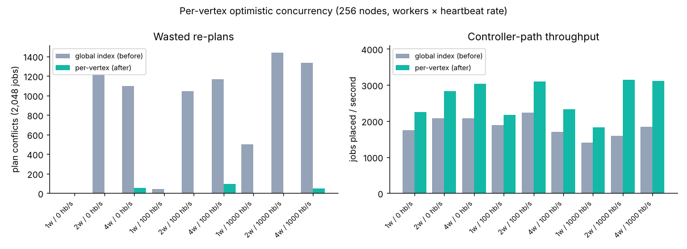
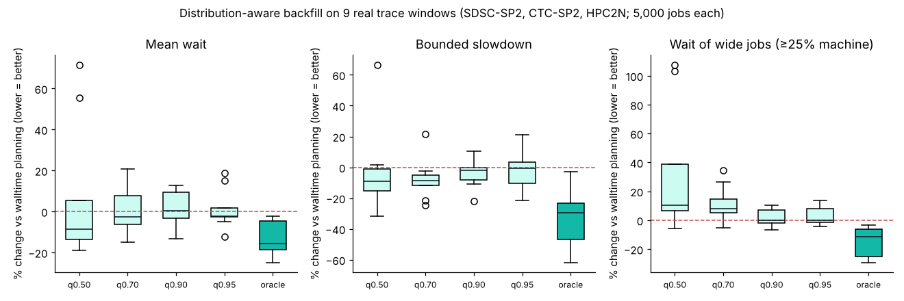
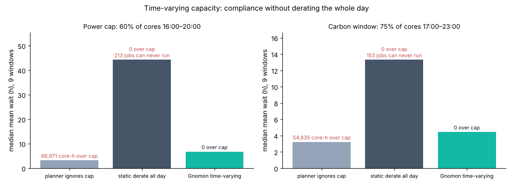

# Gnomon — evaluation of the concurrency fix and three new mechanisms

All numbers on this page are produced by code in this repository and can be regenerated
(see *Reproduce* at the end). Machine: 2-core sandbox; timings are relative, not absolute.

## Decision summary

| Change | Verdict | Default | Evidence |
|---|---|---|---|
| **Per-vertex optimistic concurrency** (+ three correctness fixes) | **Keep** | On | 92–100% fewer conflicts, 1.15–1.99× controller throughput (§1) |
| **Exact replay, counterfactuals and shadow mode** (`gnomon-sim`) | **Keep** | Tooling | Bit-identical replay; same policy reproduces all 5,000 start times; shadowing changes nothing live (§2, §5) |
| **Distribution-aware backfill** (runtime quantiles + risk budget) | **Keep, opt-in** | Off | Mechanism is safe and the oracle shows 16% lower waits / 29% lower slowdown, but the built-in per-user predictor is inconsistent and slows wide jobs (§3) |
| **Bias-corrected runtime prediction** (pinball-loss bias correction + reservation protection) | **Keep, opt-in** | Off | Lower mean wait in 9/9 windows (median −10%), −20% bounded slowdown, −13% p95 wait; median wide-job wait −3% but worse in 4/9 windows (up to +37%), so not a win on every criterion (§3b) |
| **Time-varying capacity** (power caps, carbon windows) | **Keep, opt-in per node** | Off | Zero cap violations with 85% / 67% lower median wait than static derating, and no job made unrunnable (§4) |

Everything stays. Runtime predictors ship off by default. The per-user quantile predictor (§3) is
not better than planning with the user's walltime. The bias-corrected predictor (§3b) beats it on
mean wait in all 9 windows, but wide jobs still wait longer in 4 of them. The planner mechanism they
plug into is kept because the oracle bound shows the head-room is real and the replay tooling makes
better predictors cheap to evaluate.

## 1. Per-vertex optimistic concurrency

**Problem found.** The plan applier rejected a plan if *any* event — including a node heartbeat — had
been applied since the plan's snapshot (`fsm.index() != plan.base_index`). Two further bugs sat in the
same path: a plan the resource graph rejected at commit time was still counted as committed and never
re-enqueued (the job stayed Pending forever), and nothing stopped the same job being placed twice by
two workers.

**Fix.** Every resource-graph vertex carries a version, bumped on each planner mutation. A plan records
the versions of the vertices it uses (its *read set*). At commit: if those vertices are unchanged the
plan is valid by construction and is inserted without re-checking (fast path); otherwise capacity is
revalidated and the plan is rejected only if it no longer fits. The state machine now refuses to place
a job that is not Pending and reports acceptance back to the applier.

**Measurement** (`cargo run --release -p gnomon-sched --bin occ_bench`): the real controller loop —
broker → snapshot → plan → applier, re-enqueue on conflict — with 256 nodes, 2,048 jobs and a
background thread sending heartbeats.

| workers | heartbeats/s | conflicts before → after | throughput before → after (jobs/s) | speedup |
|---|---|---|---|---|
| 1 | 0 | 0 → 0 | 1,750 → 2,248 | 1.28× |
| 2 | 0 | 1,210 → 2 | 2,073 → 2,825 | 1.36× |
| 4 | 0 | 1,096 → 56 | 2,083 → 3,039 | 1.46× |
| 1 | 100 | 45 → 0 | 1,893 → 2,172 | 1.15× |
| 2 | 100 | 1,047 → 4 | 2,231 → 3,094 | 1.39× |
| 4 | 100 | 1,167 → 94 | 1,695 → 2,327 | 1.37× |
| 1 | 1000 | 499 → 0 | 1,404 → 1,825 | 1.30× |
| 2 | 1000 | 1,440 → 4 | 1,586 → 3,151 | 1.99× |
| 4 | 1000 | 1,333 → 50 | 1,848 → 3,112 | 1.68× |



## 2. Exact replay and counterfactual evaluation

The state machine now takes an injected clock and can journal every event with the time it was applied.
Scheduling decisions are pure functions of (graph, job, now). Together that makes the production
scheduler replayable:

- `replay::verify_exact` / `rebuild` — re-apply a journal and get bit-identical state.
- `replay::workload_from_journal` — recover what was submitted and how long each job really ran, then
  re-schedule that history under a different policy with the real code (a counterfactual), instead of
  a separately maintained simulator.

E0 on 5,000 jobs of the SDSC-SP2 trace:

| check | result |
|---|---|
| journal events | 132421 (12658 KiB JSONL) |
| JSONL round-trip lossless | true |
| replayed state identical | true |
| recovered history, same policy → identical start times (5000 jobs) | true |
| simulate 5000 jobs / rebuild from journal | 979 ms / 403 ms |

## 3. Distribution-aware backfill

Each span in a vertex planner can be planned at a *predicted* length instead of the user's walltime.
`QuantileEstimator` learns each user's runtime/walltime ratio from completed jobs and plans at the θ
quantile (risk budget 1 − θ). A job that outlives its planned span is extended, never killed early —
the walltime is still the hard limit — and the next pass re-plans the reservations behind it. Tests
show the machine is never oversubscribed even when predictions are badly wrong (θ = 0.3).

Evaluated on 9 windows of 5,000 consecutive jobs from three Parallel Workloads Archive traces
(SDSC-SP2, CTC-SP2, HPC2N), conservative backfill with up to 32 reservations per pass, FCFS order,
predictors warm-started on the preceding 2,000 jobs. Changes are relative to walltime planning in the
same window.

| planning | risk budget | Δ mean wait, median (range) | Δ bounded slowdown | Δ p95 wait | Δ wide-job wait | windows better on wait | overrun extensions / job |
|---|---|---|---|---|---|---|---|
| q0.50 | 50% | -8.6% (-19…+72) | -8.9% | -5.4% | +10.4% | 6/9 | 0.58 |
| q0.70 | 30% | -2.6% (-15…+21) | -8.7% | -3.1% | +8.1% | 6/9 | 0.32 |
| q0.90 | 10% | +0.2% (-13…+13) | -1.8% | +1.5% | +0.0% | 4/9 | 0.12 |
| q0.95 | 5% | -2.3% (-12…+19) | -0.5% | +0.2% | +0.0% | 6/9 | 0.07 |
| oracle | — | -15.7% (-25…-2) | -29.4% | -12.9% | -11.4% | 9/9 | 0.00 |



**Reading.** Perfect knowledge (oracle) improves every window: 16% lower mean wait, 29% lower bounded
slowdown, and wide jobs wait 11% less. The learned per-user quantile captures only a fraction of that,
with a wide spread (−15% to +21% mean wait at θ = 0.7) and longer waits for wide jobs (+8%), because
under-predicted spans let reservations for large jobs slip. This matches the literature: Tsafrir et
al. and later studies find that prediction accuracy alone does not determine schedule quality, and that
estimation *bias* matters more than regression accuracy. Hence: mechanism kept, predictor opt-in
(`BackfillPolicy::with_estimator`), walltime remains the default. Better predictors (e.g. job-name or
script features, bias calibration, or protecting reservations of wide jobs) can now be scored with E1
in minutes; §3b does exactly that.

Per-window baseline and selected variants:

| trace | window offset | walltime: mean wait (h) | bsld | utilization | q0.70 wait | oracle wait |
|---|---|---|---|---|---|---|
| SDSC-SP2 | 10000 | 3.35 | 41.2 | 69.2% | 3.14 | 3.00 |
| SDSC-SP2 | 20000 | 4.33 | 67.0 | 79.3% | 5.04 | 3.42 |
| SDSC-SP2 | 30000 | 5.34 | 87.7 | 85.2% | 4.74 | 4.36 |
| CTC-SP2 | 10000 | 3.22 | 45.0 | 82.3% | 2.74 | 2.72 |
| CTC-SP2 | 20000 | 4.72 | 52.6 | 84.1% | 5.09 | 3.84 |
| CTC-SP2 | 30000 | 3.14 | 23.7 | 81.2% | 3.79 | 2.36 |
| HPC2N-2002 | 10000 | 1.70 | 44.5 | 59.4% | 1.66 | 1.66 |
| HPC2N-2002 | 20000 | 1.65 | 39.5 | 61.5% | 1.58 | 1.57 |
| HPC2N-2002 | 30000 | 1.13 | 32.8 | 58.5% | 1.12 | 1.08 |

## 3b. Bias-corrected runtime prediction

`BiasCorrectedEstimator` (`crates/sched/src/bias.rs`) replaces the per-user ratio quantile of §3 with
three parts:

1. **Base prediction.** An exponentially weighted mean of ln(runtime / walltime) over a feature
   hierarchy (global → requested-walltime bucket → walltime × cores bucket → user → user × walltime
   bucket), each level shrunk toward its parent. The job name is not used (it is `swf` in the traces).
2. **Bias correction with an asymmetric loss.** An online quantile tracker on the signed log-error of
   the base prediction, per user and shrunk toward a global tracker. Its update is the gradient of the
   pinball loss at level τ, so an under-prediction costs τ/(1−τ) times an over-prediction and the share
   of overrunning jobs converges to 1−τ (unit test: 80.0% coverage at τ = 0.8 on a stream whose
   geometric mean under-predicts). A second tracker at τ = 0.9 gives a *cautious* span.
3. **Reservation protection.** A job starts on its τ = 0.7 span but is recorded at its cautious span
   when that also fits, so later reservations rest on a cautious estimate. A job that outlives its
   prediction is re-planned to its walltime, not doubled. Once the reservation of a wide job
   (≥ 25% of the largest node) moves later, which walltime planning never does, new starts must fit
   at their cautious span and are recorded at walltime until that job has started. The policy sees the
   queue through a new `Policy::begin_pass` hook; `RuntimeEstimator::spans_on` returns the predicted,
   guard and recorded spans. `QuantileEstimator`, `BackfillPolicy::with_estimator` and every §3 row are
   unchanged (identical numbers in the regenerated CSV).

Same 9 windows and protocol as §3 (warm start on the preceding 2,000 jobs). Raw output:
`e1b_bias_corrected.csv`. "Wide better" counts windows where wide jobs wait less than under walltime
planning.

| planning | Δ mean wait, median (range) | Δ bounded slowdown | Δ p95 wait | Δ wide-job wait (worst window) | windows better on wait | wide better | overrun extensions / job |
|---|---|---|---|---|---|---|---|
| walltime | — | — | — | — | — | — | 0.00 |
| q0.70 (§3) | -2.6% (-15…+21) | -8.7% | -3.1% | +8.1% (+35) | 6/9 | 2/9 | 0.32 |
| **bc0.70-r0.90-p** (selected) | **-10.0% (-32…-5)** | **-20.0%** | **-13.5%** | **-2.7% (+37)** | **9/9** | **5/9** | 0.09 |
| bc0.70-r0.90 (no slip protection) | -10.7% (-38…+0) | -20.8% | -12.0% | +11.7% (+82) | 8/9 | 2/9 | 0.13 |
| bc0.70 (bias correction only) | -10.6% (-40…-1) | -11.1% | -6.4% | +8.4% (+47) | 9/9 | 2/9 | 0.25 |
| bc0.70-b0.90-p (cautious span blocks instead of recorded) | -8.4% (-36…-1) | -20.4% | -13.6% | +4.0% (+29) | 9/9 | 4/9 | 0.16 |
| bc0.70-r0.90-w0.25-p (wide jobs at walltime) | -11.1% (-29…-1) | -20.0% | -9.0% | +7.0% (+41) | 9/9 | 2/9 | 0.09 |
| bc0.50-r0.90-p | -14.3% (-39…-7) | -15.3% | -9.1% | +1.5% (+35) | 9/9 | 4/9 | 0.10 |
| oracle | -15.7% (-25…-2) | -29.4% | -12.9% | -11.4% (-4) | 9/9 | 9/9 | 0.00 |

Per window, mean wait and wide-job wait in hours:

| trace | window offset | walltime wait | q0.70 wait | bc wait | oracle wait | walltime wide | q0.70 wide | bc wide | oracle wide |
|---|---|---|---|---|---|---|---|---|---|
| SDSC-SP2 | 10000 | 3.35 | 3.14 | 3.14 | 3.00 | 6.46 | 6.23 | 6.14 | 5.87 |
| SDSC-SP2 | 20000 | 4.33 | 5.04 | 3.37 | 3.42 | 13.59 | 17.18 | 11.41 | 10.17 |
| SDSC-SP2 | 30000 | 5.34 | 4.74 | 4.81 | 4.36 | 15.12 | 14.31 | 12.97 | 12.28 |
| CTC-SP2 | 10000 | 3.22 | 2.74 | 2.19 | 2.72 | 10.34 | 11.87 | 10.40 | 9.70 |
| CTC-SP2 | 20000 | 4.72 | 5.09 | 3.29 | 3.84 | 19.54 | 22.11 | 19.00 | 13.83 |
| CTC-SP2 | 30000 | 3.14 | 3.79 | 2.95 | 2.36 | 13.73 | 18.47 | 17.21 | 10.11 |
| HPC2N-2002 | 10000 | 1.70 | 1.66 | 1.49 | 1.66 | 2.02 | 2.18 | 1.66 | 1.95 |
| HPC2N-2002 | 20000 | 1.65 | 1.58 | 1.56 | 1.57 | 1.95 | 2.08 | 2.68 | 1.73 |
| HPC2N-2002 | 30000 | 1.13 | 1.12 | 1.04 | 1.08 | 2.16 | 2.27 | 2.31 | 2.03 |

**Reading.** Bias correction is what turns the predictor from inconsistent into a consistent win: the
selected variant lowers mean wait in all 9 windows (median −10%, against −2.6% and 6/9 for q0.70),
and cuts bounded slowdown by 20% and p95 wait by 13% (p95 wait is lower in all 9 windows), about two thirds of the oracle's head-room on
wait and slowdown. Overruns drop from 0.32 to 0.09 extensions per job. (FCFS backfill is a heuristic,
so a predictor can beat the oracle in a single window, as in CTC 10000/20000.)

Wide jobs are only partly protected. The ablations show where their extra wait came from. Planning the
wide jobs themselves at walltime makes them wait *longer* (+7%): it pushes the reservation of the
next wide job out and lets long narrow jobs fill the gap. Blocking narrow jobs whose cautious span
does not fit in front of a reservation helps less than recording that span. What matters most is that
a reservation, once made, does not slip: without slip protection wide jobs wait +12% (worst window
+82%). With it the median wide-job wait is 2.7% *below* walltime planning, but only in 5 of 9 windows:
CTC 30000 (+25%) and HPC2N 20000 (+37%, on a 2-hour base) remain clearly worse. The result is also
sensitive to the planning levels: during tuning, τ = 0.6 / 0.8 or a cautious level of 0.85 / 0.95 gave
the same 8–9/9 wait wins but a median wide-job change of +1% to +13%, so the −2.7% sits in a noisy
region, not a robust optimum. On the 9 windows the selected variant meets the stated target (lower
mean wait in most windows, median wide-job wait not worse) but not "wide jobs never worse".

**Decision.** Keep `BiasCorrectedEstimator` as the recommended predictor, **opt-in**
(`BackfillPolicy::with_estimator(.., Arc::new(BiasCorrectedEstimator::new(BiasConfig::default())))`);
walltime planning stays the default because the predictor does not win on every criterion in every
window (wide jobs wait longer in 4/9 windows, bounded slowdown is 2–6% higher in two SDSC-SP2 windows).
Next steps: protect wide reservations directly in the planner (keep a slipped
reservation's start fixed and plan the jobs around it), and check the result on more windows.

## 4. Time-varying capacity

A vertex can carry a `CapacityProfile` — piecewise-constant capacity that may repeat daily. The planner
sweep treats profile breakpoints like span edges, so placement and backfill respect it natively, and it
is set through a replicated `NodeProfileSet` event. Scenarios on the same 9 windows: a demand-response
power cap (60% of cores 16:00–20:00 UTC daily) and a carbon window (75% of cores during the six
highest-intensity hours of a stylised duck-curve grid, 10 W/core). Three ways to run a machine under the
cap are compared: ignore it, derate the machine to the cap all day (the time-blind way to comply), or
let Gnomon's planner see the profile.

| scenario | planner | median mean wait (h) | median bsld | core-hours above cap (9 windows) | jobs never run | kg CO₂ (9 windows) |
|---|---|---|---|---|---|---|
| Power cap 60%, 16:00–20:00 | ignores cap | 3.22 | 44.5 | 66,971 | 0 | 4,862 |
| Power cap 60%, 16:00–20:00 | static derate all day | 44.27 | 766.0 | 0 | 213 | 4,614 |
| Power cap 60%, 16:00–20:00 | Gnomon time-varying | 6.78 | 95.5 | 0 | 0 | 4,917 |
| Carbon window 75%, 17:00–23:00 | ignores cap | 3.22 | 44.5 | 54,835 | 0 | 4,862 |
| Carbon window 75%, 17:00–23:00 | static derate all day | 13.31 | 193.7 | 0 | 153 | 4,672 |
| Carbon window 75%, 17:00–23:00 | Gnomon time-varying | 4.45 | 63.0 | 0 | 0 | 4,776 |



**Reading.** The time-varying planner is fully compliant at a fraction of the cost of static derating
(median wait −85% under the power cap, −67% under the carbon window) and still runs every job; static
derating makes the widest jobs impossible to run (its lower CO₂ total is because those jobs never ran).
As a *carbon* lever a blunt capacity cap is weak (−1.8% CO₂ vs ignoring it, and the power cap shifts work
into dirtier evening hours, +1.1%). Real carbon savings need deferrable job classes and congestion-aware
start-time coordination (COAST); the capacity profile is the mechanism those policies can build on.

## 5. Shadow mode

`ShadowPolicy` wraps the live policy, computes a candidate's decision against the same graph and time
for every placement, applies only the live decision and records disagreements (placement only: action,
start time and vertices).

| measure | value |
|---|---|
| decisions compared | 211806 |
| agreement | 93.6% |
| candidate would start a job the live policy deferred/reserved | 6709 |
| live schedule unchanged by shadowing | true |

## 6. Planner rewrite and the original benchmark

The per-vertex planner's `earliest_fit` was rewritten from an O(S³) rescan into a single sweep over a
usage step-function (O(S log S) in the number of spans), validated against a brute-force oracle on 400
random cases including periodic capacity profiles. Spans now carry their job, so completion releases the
rest of a reserved window. Re-running the original planning benchmark (`bench_results.csv`): the serial
baseline got 1.5–9.7× faster and the parallel core 1.0–3.8× faster. As a result the serial loop now beats
the parallel path on small bursts (≤1,024 jobs), where the parallel path's snapshot copy and thread
start-up dominate sub-millisecond runs; the parallel core still wins by 1.5–1.6× at 4,096–8,192 jobs.

## Limitations

- Simulation, not a cluster: SWF traces record processor counts, so the machine is one vertex with
  N processors; there is no network, I/O or Raft replication cost.
- FCFS priority only; Slurm multifactor/fair-share orders would change absolute numbers.
- The carbon curve is stylised, not a measured grid; capacity profiles use UTC time-of-day.
- 2-core sandbox: worker-scaling results understate multi-core hardware.

## Reproduce

```sh
# traces: Parallel Workloads Archive SWF files (SDSC-SP2-1998-4.2-cln, CTC-SP2-1996-3.1-cln, HPC2N-2002-2.2-cln)
cargo run --release -p gnomon-sim --bin experiments -- <dir-with-swf> results 5000
cargo run --release -p gnomon-sim --bin experiments -- <dir-with-swf> results 5000 --only e1   # E1/§3b alone
cargo run --release -p gnomon-sched --bin occ_bench > results/occ_conflicts.csv
cargo run --release -p gnomon-sched --bin bench > bench_results.csv
```

Raw data: `e1_runtime_quantiles.csv`, `e1b_bias_corrected.csv` (§3b subset of E1), `e2_capacity_profiles.csv`, `occ_conflicts.csv`,
`SUMMARY_raw.md` (E0/E3), `e0_sample_journal_head.jsonl` (journal format sample).

## References

- Parallel Workloads Archive (Feitelson et al.): https://www.cs.huji.ac.il/labs/parallel/workload/
- Nissimov & Feitelson, *Probabilistic Backfilling* (JSSPP 2007): https://cris.huji.ac.il/en/publications/probabilistic-backfilling/
- Survey of runtime-estimate effects on backfilling (Tsafrir et al. 2007, Fan et al. 2017 and others): https://arxiv.org/pdf/2109.09269
- Gibbs & Candès, *Adaptive Conformal Inference Under Distribution Shift* (NeurIPS 2021) — online quantile tracking behind §3b: https://arxiv.org/abs/2106.00170
- Gundla, *Beyond Regression Accuracy* (2026) — estimation bias vs accuracy: https://www.proquest.com/docview/3353132919/$N
- Sustainability in HPC — carbon-aware backfill plugins for Slurm/Flux: https://arxiv.org/pdf/2309.13473
- COAST — congestion-aware start times for carbon-aware HPC jobs: https://arxiv.org/pdf/2609.05443
- Slurm simulator validation (≤1.7% deviation): https://www.dcs.warwick.ac.uk/pmbs/pmbs18/PMBS/abstracts/paper9.html
