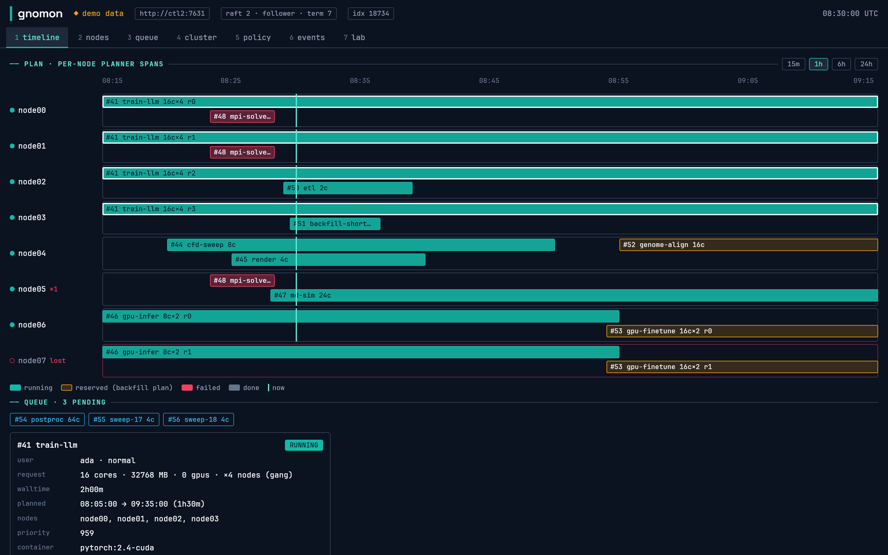
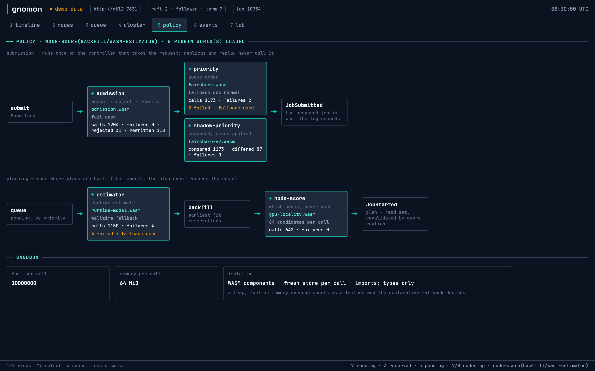
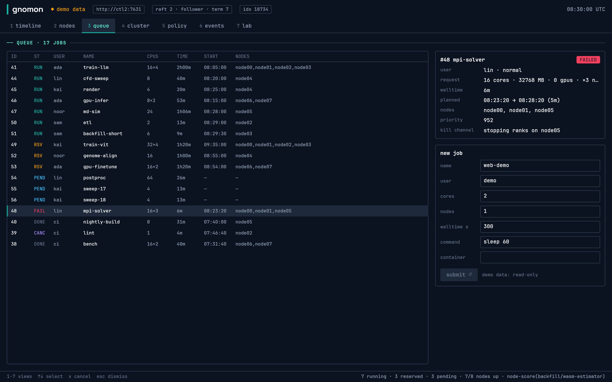
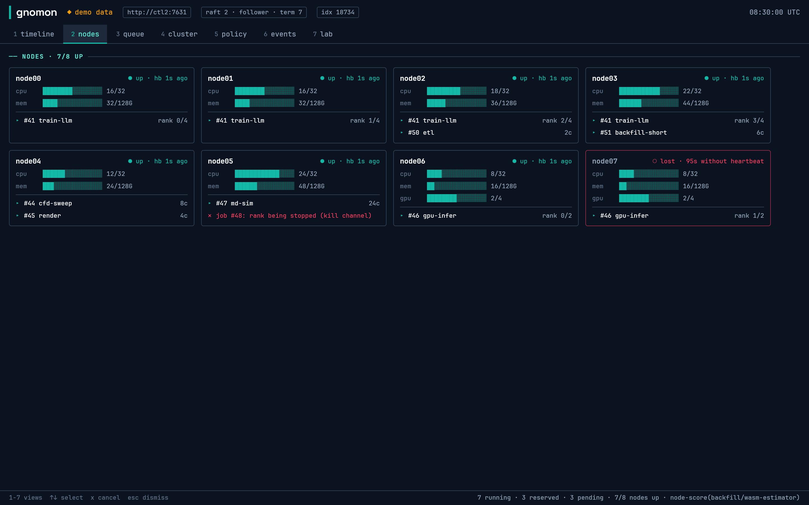
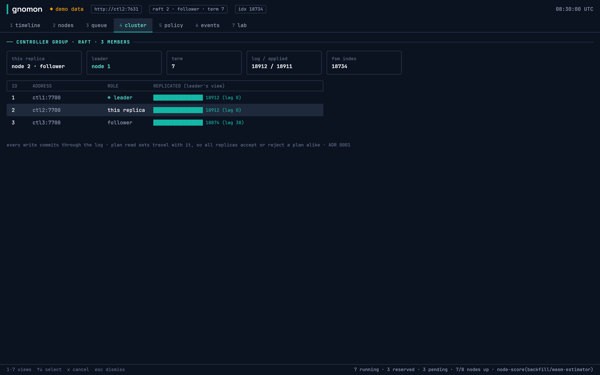
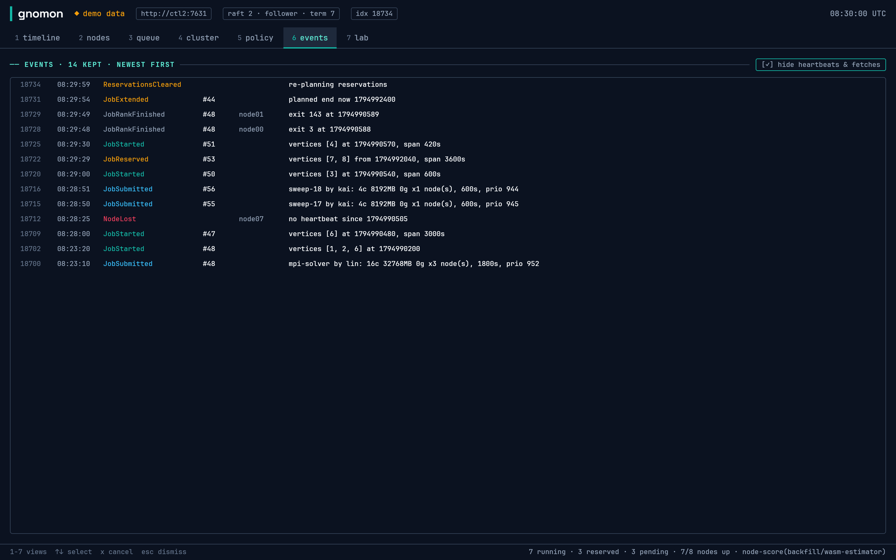
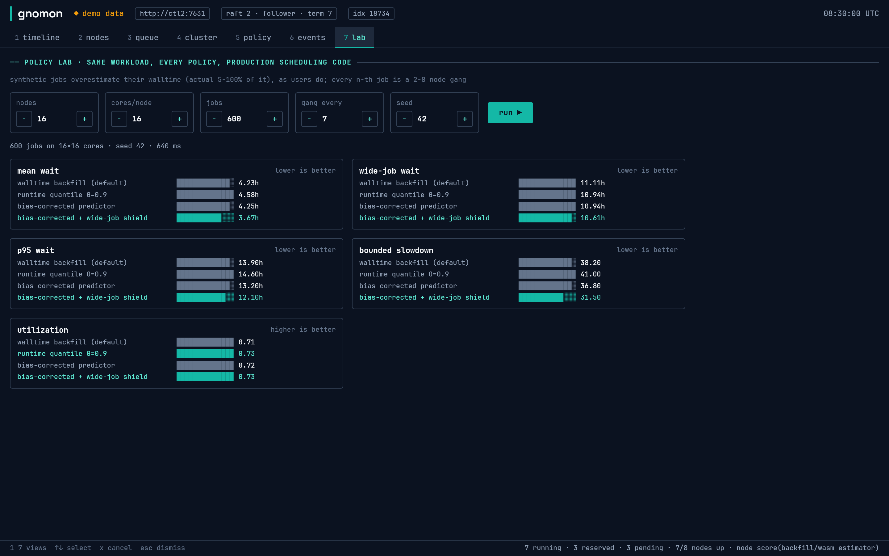

# Gnomon web UI

A terminal-styled browser UI that shows everything Gnomon does, live. It is a
[Rune](https://github.com/anomalyco/rune) app (Rust, compiled to WebAssembly, drawn with WebGPU)
served by [`gnomon-web`](../crates/web), which follows the controllers and streams their state to
the page.

| Key | View | What it shows |
|---|---|---|
| `1` | timeline | each node's planner on a time axis: running spans, backfill reservations, the now-line, the queue still waiting for a place |
| `2` | nodes | every agent: liveness, CPU/memory/GPU in use, the ranks it runs, ranks on the kill channel |
| `3` | queue | jobs (`gnqueue`, live); job detail and cancel; a new-job form (gangs, containers) |
| `4` | cluster | the Raft controller group: role, leader, term, how far each member has replicated the log |
| `5` | policy | the WASM plugin pipeline (admission, priority, shadow priority, estimator, node-score; ADR 0002-0004) with live call, failure, rejection and rewrite counters, and the sandbox limits |
| `6` | events | the state machine's event feed, newest first |
| `7` | lab | one synthetic workload under each scheduling policy (walltime backfill, runtime quantile, bias-corrected predictor, wide-job shield), run on the server with the production code |



| | |
|---|---|
|  |  |
|  |  |
|  |  |

The screenshots show the built-in sample data (`?demo`). Its lab numbers are illustrative; the live
lab shows what the server's `gnomon-sim` run returns. They are drawn by Rune's own renderer, natively
and headless, from the app's scenes, so they are the same views the browser draws:

```sh
cd ui && for v in timeline nodes queue cluster policy events lab; do
  cargo run -q -p gnomon-ui -- --scene $v --snap ../docs/web-ui/$v.png --size 1440x900
done
```

(This needs a Vulkan driver, e.g. Mesa's lavapipe on a machine without a GPU.)

`↑`/`↓` move the queue selection, `x` cancels the selected job, `Esc` dismisses. The colours are the
brand palette ([`assets/logo/BRAND.md`](../assets/logo/BRAND.md)): Ink background, Slate panels,
Paper text, Signal Teal accent; job states follow `gntop`. The type is the brand's too, bundled
in [`assets/fonts`](assets/fonts) (SIL OFL 1.1) and compiled into the app, so the browser and the
snapshots draw the same faces: JetBrains Mono Medium throughout (Bold for emphasis), and the
wordmark in Space Grotesk SemiBold, lowercase, tracked −2%. `SpaceGrotesk-SemiBold.ttf` is a static
instance (wght 600) of the variable font from Google Fonts.

## Run it

```sh
ui/build.sh                                   # → ui/dist (release; --dev for a fast build)
cargo run --release -p gnomon-web -- --ui-dir ui/dist
# open http://127.0.0.1:8080  (GNOMON_ADDR picks the controller(s), as for the CLIs)
```

Or the whole thing at once, with a 3-controller Raft group running every plugin world, six agents
and a load generator:

```sh
ui/build.sh && testkit/web-demo.sh start      # http://127.0.0.1:8080
testkit/web-demo.sh failover                  # kill the leader; watch the cluster view
testkit/web-demo.sh stop
```

`http://…/?demo` (or `?demo=policy`, `?demo=queue`, …) shows built-in sample data without a
controller, which is how the screenshots are made.

`gnomon-web` binds to `127.0.0.1` by default: the gRPC API has no authentication and the UI can
submit and cancel jobs. `--read-only` turns those off.

## Build requirements

- `rustup`: [`rust-toolchain.toml`](rust-toolchain.toml) pins Rust 1.99.1 with the
  `wasm32-unknown-unknown` target, as Rune requires; it installs on first use.
- `wasm-bindgen-cli` 0.2.129: `cargo install wasm-bindgen-cli --version 0.2.129 --locked`.
- `python3` ≥ 3.11 and `git`. `build.sh` fetches Rune's build script at the pinned revision into
  `ui/.rune` (git-ignored).

## Browser requirements

Rune's web target draws through **WebGPU** and has no fallback yet: current Chrome, Edge and Safari,
or Firefox with `dom.webgpu.enabled`. The page must come from `localhost` or HTTPS. Without WebGPU
the page says so, and the JSON (`/api/state`, `/api/events`, `/api/stream`) still works.
(Rune's `webgl` feature does not build at the pinned revision.)

Tested so far: the wasm build boots in headless Chromium and connects. With only a software WebGPU
adapter (SwiftShader, as in CI-style containers) Rune's canvas captures blank, sometimes falling back
to its CPU renderer, which draws correctly. Rune's own `web-hello` example does the same there. The
browser render on a real GPU has not been checked yet.

## Why a separate workspace

Rune pins Rust 1.99.1 and edition 2024, and asks apps to apply its `[patch.crates-io]` entries
(patched `wgpu-hal`, `winit` and `parley_engine`). Inside the scheduler's workspace that would move
every crate onto that toolchain and those patches, so `ui/` is a workspace of its own. The scheduler
crates stay on stable. The UI shares only the JSON types, through
[`gnomon-web-model`](../crates/web-model) (serde only).

## Layout

| Path | Purpose |
|---|---|
| `app/src/lib.rs` | entry point, keys, `?demo`, scenes |
| `app/src/main.rs` | native preview and headless snapshots (`--scene NAME --snap out.png`) |
| `app/src/views/` | one module per view |
| `app/src/net.rs` | `EventSource` on `/api/stream` and `fetch` for actions, applied with `AppHandle::update` |
| `app/src/state.rs` | app state |
| `app/src/theme.rs` | palette, bundled brand fonts, terminal typography |
| `assets/fonts/` | JetBrains Mono and Space Grotesk, with their licences |
| `app/src/fixture.rs` | sample data for `?demo` and screenshots |
| `web/index.html` | the page: brand colours and a WebGPU check before the wasm loads |
